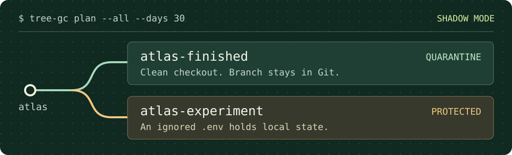

# tree-gc

Find stale Git worktrees and build output on Linux. See what can go, what should stay, and the reason for each decision. **Shadow mode is the default.** You can use the survey and planner on their own.



## Try it on two worktrees

On Linux with Git, Bash and a current Rust toolchain, run the demo from a checkout:

```sh
git clone https://github.com/imabee101/tree-gc.git
cd tree-gc
./docs/demo.sh
```

The demo creates two linked worktrees in a temporary directory and asks what the planner would do after 30 days. Both are clean according to ordinary Git status. One contains an ignored `.env`. The planner explains each decision in its own words:

```text
atlas-finished
  idle 30d (30 in-use days) >= 7d; branch finished stays in the repo

atlas-experiment
  ignored files that may not be reproducible: .env
```

The demo only requests a plan and removes its temporary workspace on exit. [Read the demo script](docs/demo.sh)

## Survey your machine

From the checkout, install the CLI and write its example configuration:

```sh
cargo install --locked --path .
tree-gc init-config
```

Open `~/.config/tree-gc/config.toml` (or the equivalent under `$XDG_CONFIG_HOME`). Review the project roots, scratch directories and Docker settings. The supplied project root is `~/projects`. Then run:

```sh
tree-gc survey          # totals by kind, including estimated size
tree-gc plan --all      # individual paths, proposed actions and reasons
tree-gc plan --days 30  # preview with a simulated clock
```

The survey’s **RECLAIM** column includes items that would move to quarantine. Moving a directory on the same filesystem frees space only when its contents are purged.

## What happens to my files?

| Kind | Cleanup action | Recovery |
| --- | --- | --- |
| Clean linked worktrees | Strip recognized build output if configured, then quarantine the checkout and its Git metadata. | Restore the checkout before purge. Stripped output may need a rebuild. |
| Missing worktrees | Quarantine eligible leftover Git metadata. | Restore the metadata before purge. |
| Local branches | Archive eligible branch tips under `refs/tree-gc/archive/`. | Restore from the archive ref. |
| Build output | Delete recognized artifacts such as Cargo `target/` and `node_modules/`. | Rebuild or reinstall. Eligible Cargo release executables can be preserved separately. |
| Agent scratch and temporary files | Quarantine eligible entries. Scratch rules can explicitly select deletion. | Restore quarantined entries before purge. System cleanup or reboot can also clear temporary storage. |
| Docker | Optionally prune old build cache and images, or remove eligible stopped containers. Volumes are retained. | Rebuild or pull images where available. Removing a container discards its writable layer. |

**The default quarantine window is 14 in-use days.** Hard disk pressure can trigger an earlier purge. Set `purge_quarantine_early = false` in the existing `[pressure]` section to disable early purge.

## Enable cleanup

Review `tree-gc plan --all` first. Place a `.tree-gc-keep` file in a directory you want to keep, or add it to `protect_paths`. To begin with branch archiving, edit the existing top-level settings:

```toml
enforce = true
enforce_kinds = ["branch"]
```

```sh
tree-gc apply --yes --kind branch --limit 1
tree-gc journal
tree-gc restore <journal-id>
```

Manual apply rechecks candidates before acting. Scheduled runs can act whenever enforcement is enabled. To install the optional systemd user timers, run `./packaging/install.sh` from the checkout. It keeps your existing config and starts both timers: a cleanup cycle about every six hours and a disk-pressure check about every five minutes.

## How the planner decides

The planner checks for local changes, ignored files, worktree locks, recent activity, mounted filesystems and processes using a path. A keep marker lets you protect work the machine cannot recognize. Between recorded runs, the age calculation uses observed activity days. Before the first recorded run, it uses calendar days.

Git remote checks use local tracking refs. Processes inside containers or another user’s session may be invisible. Protect paths explicitly when another environment depends on them. The bundled configuration also documents the age thresholds, scratch rules, Docker scope and pressure settings. [Configuration reference](packaging/config.example.toml) · [Operations guide](docs/operations.md)

## Development

Run `cargo test --locked` on Linux. The scenario tests create real Git worktrees and exercise cleanup and restore, including branch movement after planning, ignored files, interrupted operations and disk pressure.

[MIT license](LICENSE)
